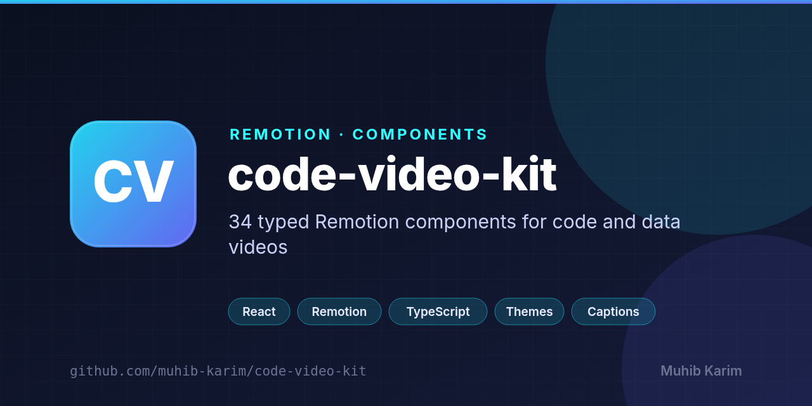

<p align="center">
  
</p>

<p align="center">
  <a href="https://github.com/muhib-karim/code-video-kit/releases/latest"></a>
</p>

<h1 align="center">code-video-kit</h1>

<p align="center"><strong>34 code-first Remotion components for launch videos, benchmark explainers and coding tutorials.</strong></p>

<p align="center">
  <a href="https://github.com/muhib-karim/code-video-kit/actions/workflows/ci.yml"></a>
  <a href="https://muhib-karim.github.io/code-video-kit/"></a>
  <a href="./LICENSE"></a>
</p>

<p align="center">
  <a href="https://muhib-karim.github.io/code-video-kit/"><strong>Live gallery</strong></a> ·
  <a href="#install">Install</a> ·
  <a href="#usage">Usage</a> ·
  <a href="#props-for-agents">Props for agents</a> ·
  <a href="#render-times">Render times</a>
</p>

---

Every component is a plain React component driven by the current frame. Each one ships with a **zod schema**, **JSON-serialisable default props** and **dark/light themes with an accent colour**. Everything is drawn with SVG and CSS: no images, no network requests, no font downloads. Renders are deterministic and work offline.

- **Typed end to end.** `z.infer` props, a `.describe()` on every field, schema validation in Remotion Studio.
- **Built for code.** A built-in tokenizer for TypeScript/JavaScript, Python and Bash; typing, diffs, step-through highlights, terminals.
- **Built for data.** Bar races, benchmark bars and line charts with a colour-vision-safe categorical palette, tabular numerals and direct labels.
- **Composable.** Drop any component into a `<Sequence>`. Frames, transitions and the spotlight accept your own `children`.
- **Tested logic.** Tokenizer, caption timing, bar-race interpolation, chart paths, diff parsing and the QR encoder are pure functions with unit tests.

## What's inside

| Group | Component | What it does |
|---|---|---|
| **Titles** | `TitleCard` | Opening title with eyebrow pill, springy headline and accent rule. |
| | `KineticTitle` | Words spring in one by one; highlighted words turn accent and underline. |
| | `SectionHeader` | Chapter divider: outlined number fills, rule grows, title slides up. |
| | `EndCard` | Closing call to action: install command types itself, then link pills appear. |
| | `LowerThird` | Name and role card that wipes in, holds, then wipes out. |
| | `CalloutBadge` | Pulsing pointer dot with a connector and an icon badge that pops in. |
| **Code** | `CodeBlock` | Syntax-highlighted editor window with staggered lines and highlighted ranges. |
| | `CodeTyping` | Code types itself character by character, keeping syntax colours and a cursor. |
| | `CodeDiffReveal` | Unified diff plays out: removed lines collapse, added lines slide in. |
| | `CodeHighlightSteps` | Step-through walkthrough: a highlight band glides between line ranges with captions. |
| | `TerminalSession` | Commands type after a prompt; output streams in and the view auto-scrolls. |
| | `FileTree` | Project tree built from flat paths, revealed row by row with highlights and notes. |
| | `CommitLog` | Git history on a branch line: hashes, messages, authors and tags in order. |
| **Captions** | `WordCaptions` | Paged word-timed captions; the spoken word pops in an accent pill. |
| | `KaraokeCaption` | Single-line caption where each word fills with accent as it is spoken. |
| | `SubtitleBar` | Classic translucent subtitle bar with a speaker label and per-cue fades. |
| **Data** | `BarChartRace` | Ranked bars race across keyframes and glide past each other, keeping their colours. |
| | `BenchmarkBars` | Horizontal benchmark bars with counting values and an "N× faster" pill. |
| | `LineChartReveal` | Multi-series line chart that draws itself, with end labels and a legend. |
| | `StatCounter` | Two to four hero numbers that count up with prefixes and suffixes. |
| | `ComparisonTable` | Feature matrix with drawn checkmarks and a highlighted recommended column. |
| | `Leaderboard` | Ranked rows slide in with score bars and ▲/▼ rank changes. |
| | `ProgressRing` | Circular progress rings fill to their values while percentages count up. |
| | `Timeline` | Horizontal timeline that draws itself; milestones pop in as it passes. |
| **Transitions & layout** | `SplitScreen` | Before/after code panels side by side with a wiping divider. |
| | `SlideTransition` | Scenes push each other off screen in any direction; accepts children as scenes. |
| | `WipeTransition` | Linear, circular or diagonal wipe between two scenes or two children. |
| | `ZoomFocus` | Camera zooms into one line of code, dims the rest and adds a note. |
| | `SpotlightMask` | Dimmed overlay with a spotlight that glides between labelled points. |
| | `GridShowcase` | Feature cards with icons pop into a grid one after another. |
| | `DeviceFrame` | CSS-drawn phone, tablet or laptop around a demo screen or your children. |
| | `BrowserFrame` | Browser window whose URL types itself, framing a page or your children. |
| | `LogoReveal` | SVG mark draws its outline then fills; the wordmark staggers in. |
| | `QRCard` | Real, scannable QR code (built-in encoder, versions 1–10) on a titled card. |

See every component in motion in the **[gallery](https://muhib-karim.github.io/code-video-kit/)**.

## Install

The package is distributed through GitHub, not the npm registry. It needs Remotion 4, React 18 or newer and zod 3.22 as peer dependencies.

From a release tarball (recommended, prebuilt):

```bash
npm i https://github.com/muhib-karim/code-video-kit/releases/download/v0.1.0/code-video-kit-0.1.0.tgz
```

From the repository (builds on install):

```bash
npm i github:muhib-karim/code-video-kit
```

Peer dependencies, if your project doesn't have them yet:

```bash
npm i remotion@4 react@18 react-dom@18 zod@3.22.3
```

## Usage

```tsx
import { Composition, Series } from 'remotion';
import { TitleCard, titleCardDefaults, CodeTyping, codeTypingDefaults, BenchmarkBars, benchmarkBarsDefaults } from 'code-video-kit';

const Launch = () => (
  <Series>
    <Series.Sequence durationInFrames={90}><TitleCard {...titleCardDefaults} title="fastkit 2.0" accent="#22D3EE" /></Series.Sequence>
    <Series.Sequence durationInFrames={210}>
      <CodeTyping {...codeTypingDefaults} code={'const app = fastkit();\napp.listen(3000);'} filename="server.ts" />
    </Series.Sequence>
    <Series.Sequence durationInFrames={150}><BenchmarkBars {...benchmarkBarsDefaults} theme="light" /></Series.Sequence>
  </Series>
);

export const Root = () => <Composition id="launch" component={Launch} durationInFrames={450} fps={30} width={1280} height={720} />;
```

Every component reads its size from `useVideoConfig()` and is designed for 1280×720 at 30 fps. The registry lists a recommended `durationInFrames` for each component's default animation.

### Themes

All components accept `theme: 'dark' | 'light'` and `accent: string` (hex). The tokens live in `src/theme.ts` and are exported: `resolveTheme(mode, accent)` returns the full palette (surfaces, text, code colours, the categorical `series` palette) if you want matching custom scenes.

### Your own content

`SlideTransition`, `WipeTransition`, `SpotlightMask`, `DeviceFrame` and `BrowserFrame` accept `children`, which replace their built-in demo content:

```tsx
<DeviceFrame {...deviceFrameDefaults} device="laptop">
  <MyAppScene />
</DeviceFrame>
```

### Captions

Caption components take word or cue timings in **seconds**, the format most transcription tools emit:

```ts
const words = [
  { text: 'Ship', startSec: 0.3, endSec: 0.62 },
  { text: 'faster', startSec: 0.62, endSec: 1.1 },
];
```

No transcript yet? `evenWordTimings(text, startSec, endSec)` spreads a script evenly across a time span.

## Props for agents

Each component is meant to be configured by a person or by a script that writes JSON. Three things make that dependable:

1. **Every prop is described.** Each schema field carries a `.describe()` string that says what it does, its units (frames vs seconds vs pixels vs percent) and sensible limits.
2. **Defaults are complete and valid.** `<name>Defaults` is a full, JSON-serialisable props object. Start from it and override only what you need. The test suite parses every default with its schema.
3. **Validate before rendering.** `schema.parse(props)` gives precise errors before a render is wasted.

```ts
import { registry } from 'code-video-kit';

// List every component, its recommended duration and the documented props.
for (const entry of registry) {
  console.log(`${entry.name} (${entry.id}, ${entry.durationInFrames} frames): ${entry.description}`);
  for (const [prop, field] of Object.entries(entry.schema.shape)) {
    console.log(`  ${prop}: ${field.description ?? ''}`);
  }
}

// Validate generated props.
const entry = registry.find((e) => e.id === 'benchmark-bars')!;
const props = entry.schema.parse({ ...entry.defaultProps, title: 'p95 latency', lowerIsBetter: true });
```

Conventions that hold across all components:

| Convention | Meaning |
|---|---|
| `theme`, `accent` | Present on every component. |
| `*Frames`, `startFrame`, `at` | Durations and offsets in frames (30 fps). |
| `startSec`, `endSec` | Caption timings in seconds. |
| `x`, `y` in `CalloutBadge` / `SpotlightMask` | Percent of frame width/height (0–100). |
| `fontSize`, `radius` | Pixels at 1280×720. |
| `language` | `'ts' \| 'js' \| 'py' \| 'bash'`. |
| `highlightLines`, `steps[].lines` | 1-based line ranges such as `"2-4,7"`. |
| Empty string | Hides an optional text element (eyebrow, subtitle, footnote...). |

The gallery also publishes a machine-readable `registry.json` with ids, groups, durations, default props and a ready-to-paste usage snippet for each component.

## Render times

The gallery workflow renders every composition on a GitHub-hosted runner (h264, crf 28, scale 0.5, Remotion concurrency 2, one composition at a time). It times each `renderMedia` call and publishes `results/render-times.json` and `results/render-times.md` as a workflow artifact and in the job summary. The live gallery shows ms/frame on each card.

**Measured:** 34 compositions, 5,256 frames in 164.3 s of render time, **31.3 ms/frame on average** (range 28 to 36.6) at 640x360, on a 4-core AMD EPYC 7763 GitHub Actions runner with Node 20 and Remotion 4.0.290. Bundling took 3.3 s once and is excluded. Numbers are copied from gallery run [39064919949](https://github.com/muhib-karim/code-video-kit/actions/runs/39064919949), not estimated.

<details><summary>Per-component table</summary>

| Component | Frames | Render (ms) | ms / frame |
|---|---:|---:|---:|
| `bar-chart-race` | 330 | 9241 | 28 |
| `benchmark-bars` | 150 | 4722 | 31.48 |
| `browser-frame` | 150 | 4783 | 31.89 |
| `callout-badge` | 90 | 3083 | 34.25 |
| `code-block` | 120 | 3998 | 33.31 |
| `code-diff-reveal` | 180 | 5524 | 30.69 |
| `code-highlight-steps` | 225 | 6926 | 30.78 |
| `code-typing` | 210 | 6181 | 29.44 |
| `commit-log` | 120 | 4000 | 33.34 |
| `comparison-table` | 150 | 4786 | 31.9 |
| `device-frame` | 120 | 3968 | 33.07 |
| `end-card` | 120 | 3925 | 32.71 |
| `file-tree` | 120 | 3969 | 33.08 |
| `grid-showcase` | 120 | 4016 | 33.47 |
| `karaoke-caption` | 200 | 5875 | 29.37 |
| `kinetic-title` | 90 | 3108 | 34.53 |
| `leaderboard` | 150 | 4821 | 32.14 |
| `line-chart-reveal` | 180 | 5326 | 29.59 |
| `logo-reveal` | 120 | 3862 | 32.19 |
| `lower-third` | 150 | 4658 | 31.05 |
| `progress-ring` | 120 | 3952 | 32.93 |
| `qr-card` | 120 | 3997 | 33.31 |
| `section-header` | 75 | 2748 | 36.64 |
| `slide-transition` | 186 | 5511 | 29.63 |
| `split-screen` | 120 | 3996 | 33.3 |
| `spotlight-mask` | 210 | 6198 | 29.51 |
| `stat-counter` | 120 | 3931 | 32.76 |
| `subtitle-bar` | 240 | 6895 | 28.73 |
| `terminal-session` | 240 | 7235 | 30.14 |
| `timeline` | 180 | 5309 | 29.5 |
| `title-card` | 90 | 3140 | 34.89 |
| `wipe-transition` | 120 | 3992 | 33.27 |
| `word-captions` | 190 | 5642 | 29.69 |
| `zoom-focus` | 150 | 5013 | 33.42 |
| **Total** | **5256** | **164331** | **31.27** |

</details>

## Development

```bash
npm install            # also builds dist/ via the prepare script
npm run studio         # open Remotion Studio with every component
npm run typecheck      # tsc --noEmit
npm test               # vitest
npm run build          # tsup -> dist/ (ESM + .d.ts)
npm run emit:registry  # dist registry -> gallery/registry.json
npm run render:all     # render gallery/media/*.mp4 + posters, write results/render-times.*
```

Serve `gallery/` with any static file server to preview the gallery locally.

Repository layout:

```
src/components/   one file per component (component, schema, defaults)
src/lib/          pure, tested helpers (tokenizer, captions, bar race, charts, diff, file tree, QR)
src/theme.ts      design tokens
src/registry.ts   every component with composition settings
src/Root.tsx      one <Composition> per registry entry
tests/            vitest suites
scripts/          render-all.mjs, emit-registry.mjs
gallery/          static gallery (HTML, CSS, JS; no dependencies)
```

CI runs on every push and pull request: install, typecheck, test, build, `npm pack` (the tarball is uploaded as an artifact). The gallery workflow deploys to GitHub Pages on every push to `main`; enable it once under **Settings → Pages → Source: GitHub Actions**. To release, bump `version` in `package.json`, add a `CHANGELOG.md` entry and push a tag `vX.Y.Z`. The release workflow attaches the tarball to a GitHub Release.

## Tech stack

- **Components:** React, Remotion, TypeScript
- **Build:** tsup (ESM + .d.ts), vitest, `tsc --noEmit`
- **Gallery:** rendered with Remotion on GitHub Actions, published to GitHub Pages

## Contributing

Issues and pull requests are welcome. Run `npm run typecheck && npm test` (see [Development](#development)) before opening a pull request. Please keep each pull request focused and say how you tested it.

## License

[MIT](./LICENSE) © 2026 Muhib Karim. If you use this in research or writing, see [`CITATION.cff`](./CITATION.cff).
